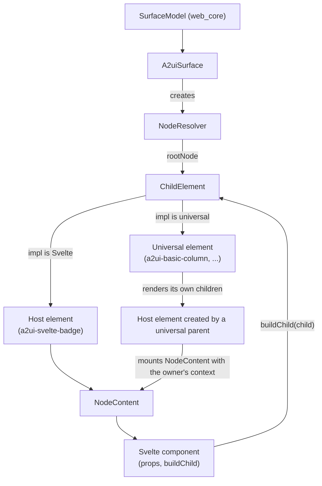

# Svelte renderer design

This document describes how `@conalog/a2ui-svelte` renders A2UI surfaces with Svelte 5. It follows the [framework adapter blueprint](https://github.com/a2ui-project/a2ui/blob/main/blueprints/modules/a2ui_framework_adapter.blueprint.md) and the [universal custom elements feature blueprint](https://github.com/a2ui-project/a2ui/blob/main/blueprints/features/universal_custom_elements.blueprint.md) of the official A2UI repository, and mirrors the layout of the official React renderer (`typescript/renderers/react`) so that the package can move into the official repository as `typescript/renderers/svelte` (`@a2ui/svelte`) without restructuring.

Each decision at the end of this document records who made it. A decision marked "unconfirmed" was made by the agent that wrote the first version and has not been reviewed by a maintainer yet.

## 1. Scope

The package renders a `SurfaceModel` from `@a2ui/web_core` as a Svelte component tree. It does not process messages, negotiate capabilities, call agent functions, or talk to a transport. Those belong to `MessageProcessor` in `@a2ui/web_core` and to the application.

The package provides:

1. `A2uiSurface`, the Svelte component that renders one surface.
2. `createComponentImplementation`, which turns a Svelte component into a catalog entry, so an application can register its own components next to the basic catalog.
3. The host elements, host registry and catalog preparation that let Svelte components and the shared basic catalog elements nest in either order.
4. Markdown context for the basic catalog `Text` component and for custom components.

The basic catalog itself is not reimplemented. As in the React, Lit and Angular renderers, it comes from `@a2ui/web_core/catalogs/basic/v1` as universal custom elements, and the Svelte renderer registers those entries.

## 2. Supported versions

| Dependency       | Range                                                                                           |
| ---------------- | ----------------------------------------------------------------------------------------------- |
| A2UI protocol    | v1.0, plus v0.9 and v0.9.1 surfaces that `web_core` renders                                     |
| `@a2ui/web_core` | `^0.16.1` (peer dependency)                                                                     |
| `svelte`         | `^5.29.0` (peer dependency; `{@attach}` landed in 5.29)                                         |
| `zod`            | `^3.25.76` (peer dependency, same as `@a2ui/web_core`)                                          |
| SvelteKit        | optional; the package imports nothing from `$app/*`. The explorer and its tests use SvelteKit 3 |
| Node.js          | `>=18` where the package runs (its `engines`); `>=22.17` to develop it                          |

v0.8 is not supported; `web_core` keeps it under a separate legacy API.

`@a2ui/web_core` is a peer dependency, not a dependency. The application imports `MessageProcessor` and `basicCatalog` from it directly, and two copies on one page would break `instanceof` checks, the per-surface `WeakMap`s, and custom element registration (the same tag name defined by two classes throws). `web_core` releases often and is still at 0.x, so a caret range pins one minor version. Each `web_core` minor release gets a renderer release that widens or moves the range after the conformance suites pass against it.

## 3. Package layout

The repository mirrors the paths of the official repository, so files keep their place when the package moves upstream:

```text
a2ui-svelte/
├── typescript/renderers/svelte/        # the published package
│   ├── src/
│   │   ├── index.ts                    # public API
│   │   ├── A2uiSurface.svelte          # surface host
│   │   ├── ChildElement.svelte         # node dispatcher
│   │   ├── NodeContent.svelte          # renders a Svelte implementation for one node
│   │   ├── adapter.ts                  # createComponentImplementation
│   │   ├── svelte_component_implementation.ts  # catalog entry and prop types
│   │   ├── node-view.svelte.ts         # fromSignal, view props, surface context
│   │   ├── host_registry.ts            # owners and hosts per surface
│   │   ├── markdown-context.ts
│   │   ├── markdown_hosts.ts           # Markdown rendered by a Svelte component
│   │   └── catalog/
│   │       ├── host_accessibility.ts
│   │       ├── prepare_catalogs.ts
│   │       ├── svelte_host_element.svelte.ts
│   │       └── to_web_component.ts
│   ├── tests/                          # Vitest (jsdom) and Vitest browser mode
│   └── a2ui_explorer/                  # SvelteKit gallery app and its end-to-end tests
├── conformance/                        # copied from the official repository (section 12)
├── catalogs/basic/                     # copied from the official repository (section 12)
├── blueprints/                         # the codebase blueprint, in the official format
└── docs/
```

`src/` follows the React renderer file by file where the concept is the same. Svelte components use PascalCase file names, as Svelte projects do.

## 4. Rendering model



1. `A2uiSurface` takes a `SurfaceModel`. In a client-side effect it prepares the surface's catalogs, creates one `NodeResolver`, and tracks `resolver.rootNode`. When the surface prop changes it disposes the old resolver and creates a new one; when the component unmounts it disposes the resolver. During server-side rendering no effect runs, so the surface renders nothing and creates no resolver.
2. `ChildElement` renders one `ComponentNode`. A node that is not `resolved` (`pending`, `unknown-type`, `cyclic`) renders nothing and takes no layout space; the resolver has already reported unknown types and cycles to the surface. A resolved node renders its implementation's custom element with `<svelte:element this={tagName}>` and assigns `node` to it. The element is reused while the tag name stays the same and recreated when it changes, which is the reuse rule of the universal custom elements blueprint.
3. For a Svelte implementation the element is a host element, and `ChildElement` renders `NodeContent` as its children. `NodeContent` subscribes to `node.props`, converts the resolved props to view props (section 5), and renders the implementation's component with `props`, `buildChild`, `node`, `metadata`, `accessibilityRef` and `validationErrorsRef`.
4. A universal element renders its own children. When one of them is a Svelte implementation, the universal element creates the host element itself. The host finds the nearest element above it that Svelte rendered, and mounts `NodeContent` into itself with that element's Svelte context (captured with `getAllContexts()`). The Svelte content therefore reads the same context as it would without the universal element in between. DOM events bubble through the real DOM as usual. A `<svelte:boundary>` above the universal element does not catch errors from content mounted this way, because `mount` starts a new root; this is a known difference from the React renderer, which uses portals.

### Child references and identity

Core resolves child references into `ComponentNode`s. View props replace each child node with a string token, the node's `instanceId`, and `buildChild` takes the token back. An implementation renders children like this:

```svelte
{#each props.children as child (child)}
  {@render buildChild(child)}
{/each}
```

The token is `instanceId` because Svelte keys a list at the `{#each}` block, not at the element `buildChild` returns. `instanceId` is unique among one parent's children, follows its component through a reorder of an explicit child list, stays with its index in a template, and survives a placeholder being replaced by the component that arrived. The React renderer uses `node.id` as the token because React keys the element; `node.id` changes whenever core replaces the node object, so the Svelte renderer would remount views that should stay.

When the node behind a token changes type, the tag name changes, and Svelte recreates the element and the implementation component. That resets view state, as the blueprint requires.

## 5. Reactivity bridge

`web_core` exposes state as signals (`@preact/signals-core` by default). The renderer reads them through one helper, `fromSignal`, built on `createSubscriber` from `svelte/reactivity`:

```ts
export function fromSignal<T>(signal: Signal<T>): {readonly current: T} {
  const subscribe = createSubscriber(update => {
    let first = true;
    return effect(() => {
      getValue(signal);
      if (first) first = false;
      else update();
    });
  });
  return {
    get current() {
      subscribe();
      return peekValue(signal);
    },
  };
}
```

The subscription starts the first time an effect or template reads `current`, and it stops when no effect reads it any more. A view that unmounts therefore drops its subscription without extra code, which covers the teardown obligations in the adapter blueprint. Reading `current` outside a reactive context returns the value without subscribing.

Updates reach only the component whose data changed:

1. Core emits `node.props` only when that node's resolved properties change, and once per update.
2. Each `NodeContent` reads only its own node's `props`, so a change re-runs one `$derived` and one implementation component. Its parent and siblings do not re-run.
3. Svelte props are passed as getters, so `metadata` is subscribed only if the implementation reads it.
4. Inside the component, Svelte updates only the DOM that reads a changed value.

Input state survives updates because the renderer never recreates an element for a data change. Elements are recreated only when a node's type, and with it the tag name, changes. When a user types into an `<input value={props.value}>`, the write goes through the binding to the data model and comes back as the same string; Svelte does not reassign an input value that already matches, so the caret and selection stay where they were. The basic catalog's own controls are Lit elements and keep their state the same way.

## 6. Public API

Names follow the React renderer where the concept does not depend on the framework. Where React uses a hook, the Svelte renderer uses the Svelte form (`get...` for context, `from...` for a reactive value).

| React (`@a2ui/react`)                                          | Svelte                                          | Notes                                                                                 |
| -------------------------------------------------------------- | ----------------------------------------------- | ------------------------------------------------------------------------------------- |
| `A2uiSurface`                                                  | `A2uiSurface`                                   | `<A2uiSurface {surface} />`                                                           |
| `createComponentImplementation(api, View)`                     | `createComponentImplementation(api, Component)` | Keeps `allowedParents`, `allowedChildren` and `metadata`.                             |
| `ReactComponentImplementation`                                 | `SvelteComponentImplementation`                 |                                                                                       |
| `ReactCatalogComponent`                                        | `SvelteCatalogComponent`                        | A Svelte implementation or a universal element.                                       |
| `ReactA2uiComponentProps<T>`                                   | `SvelteA2uiComponentProps<T>`                   | `props`, `buildChild`, `node`, `metadata`, `accessibilityRef`, `validationErrorsRef`. |
| `NodeBuildChild`                                               | `NodeBuildChild`                                | A snippet: `{@render buildChild(child)}`.                                             |
| `useA2uiSurface()`                                             | `getA2uiSurface()`                              |                                                                                       |
| `useSignalValue(signal)`                                       | `fromSignal(signal).current`                    |                                                                                       |
| `MarkdownContext`, `useMarkdownRenderer()`                     | `setMarkdownContext()`, `getMarkdownContext()`  | A function that returns HTML, such as `@a2ui/markdown-it`'s `renderMarkdown`.         |
| `MarkdownComponentContext`                                     | `setMarkdownComponentContext()`                 | A Svelte component that renders Markdown in the app's tree.                           |
| `createBinderlessComponentImplementation`, `render`, `context` | not provided                                    | Deprecated compatibility paths in React; a new package has no callers.                |

The props an implementation receives have the type `ResolveA2uiProps` from `web_core`: dynamic values arrive resolved, each writable value has a `set<Name>` setter, actions arrive as functions, and child references arrive as tokens. A read-only binding gets a setter that does nothing, as in React.

Actions are called synchronously from the native event handler, so a function that requires user activation (`openUrl`) sees the gesture. The renderer does not debounce, defer or inspect actions.

## 7. Accessibility

Host elements call `bindHostAccessibility` from `@a2ui/web_core/universal` while connected, so every Svelte implementation gets the protocol attributes without code of its own:

1. `aria-live`, `aria-hidden` and `inert` go on the host element.
2. `aria-label` and `aria-description` go on the element the implementation passes to `accessibilityRef` (`<input {@attach accessibilityRef}>`). Without one, they go on the host with `role="group"`, unless the host already has a role.
3. The `accessibilityRef` element gets `aria-invalid` while a check fails, and `aria-describedby` pointing at the element passed to `validationErrorsRef` while there are errors.

`accessibilityRef` and `validationErrorsRef` are Svelte attachments. On v1.0 the attributes are read from `@accessibility`; before v1.0, from `accessibility`. A custom v1.0 property named `accessibility` reaches the implementation unchanged.

## 8. Theming

The renderer reads no theme. A v1.0 surface carries no `theme`, and the renderer never applies one. The basic catalog elements style themselves from `--a2ui-*` CSS custom properties with documented defaults; `injectBasicCatalogStyles()` from `web_core` adopts the default stylesheet. An application themes the surface by setting those properties on `:root` or on a container, or by applying the `.a2ui-dark` and `.a2ui-light` classes. Svelte implementations are the application's own components and use the application's styles.

## 9. Security

The renderer treats every agent message as untrusted.

1. Only registered components render. A component type that is not in the surface's catalogs resolves to an `unknown-type` placeholder, which renders nothing; core reports `UNKNOWN_COMPONENT_TYPE` to the surface.
2. The renderer does not evaluate code. Neither the renderer nor `web_core` uses `eval`, `new Function`, or string timers; `web_core` parses expressions with its own parser. ESLint forbids `eval`, `new Function`, and implied eval in the package.
3. The renderer never turns agent data into DOM attributes or HTML. View props are passed to Svelte components as values. The package does not use `{@html}`, and ESLint forbids it. An implementation that spreads agent data onto an element must filter it itself; the README shows how, including dropping `on*` keys.
4. Markdown is HTML-escaped unless the application installs a renderer. `@a2ui/markdown-it` sanitizes its output with DOMPurify. A Svelte Markdown component receives the Markdown source as a string and decides how to render it.
5. URLs are filtered in `web_core`. Media components accept `http:`, `https:` and `data:` (`sanitizeMediaUrl`), and `openUrl` accepts `http:`, `https:`, `mailto:` and `tel:` and opens with `noopener,noreferrer`. Custom components that render agent URLs should pass them through `sanitizeMediaUrl` from `@a2ui/web_core`.
6. `openUrl` runs only during a user gesture (`requiresUserActivation`), which the renderer preserves by calling actions synchronously.

## 10. Transport

The package contains no transport code. The official renderers contain none either: the official client integration guide shows the application reading messages from its transport and passing them to `MessageProcessor.processMessagesAsync`, and sending actions back from the processor's action callback. The README shows the same for JSON Lines over `fetch` and for Server-Sent Events, in a few lines each. Over MCP, the application reads the `a2ui://` resource with its MCP client and passes the messages on the same way.

## 11. Server-side rendering

Importing the package on the server must work, because SvelteKit renders pages there:

1. Modules that define element classes choose the base class when they load (`HTMLElement` when it exists, an empty class otherwise), as the React renderer does since 0.16.1.
2. `A2uiSurface` creates the resolver in `$effect`, which does not run on the server, so the server renders an empty surface and the client renders the surface after hydration.
3. The basic catalog elements produce no server markup, as in the other web renderers.

A test imports the package in plain Node without a DOM. The explorer app is built with SvelteKit and loaded through its server.

## 12. Testing

| Layer            | Tool                                           | What it covers                                                                                                                                                                                                                                                  |
| ---------------- | ---------------------------------------------- | --------------------------------------------------------------------------------------------------------------------------------------------------------------------------------------------------------------------------------------------------------------- |
| Unit and adapter | Vitest with jsdom                              | `conformance/core/adapter_conformance.yaml`, `conformance/core/accessibility.yaml` (attribute checks), `conformance/adapter/adapter_conformance_v0_9.yaml`, `conformance/e2e` renderer half, package exports, import without a DOM, host and registry behavior. |
| Browser          | Vitest browser mode with Playwright (Chromium) | The same conformance suites in a real browser, including the axe-core rules that jsdom cannot run, and input focus and caret retention.                                                                                                                         |
| End to end       | Playwright against the built explorer          | Every v1.0 and v0.9 basic catalog example renders without console errors in a SvelteKit build served by its Node server, and interactive examples respond to input.                                                                                             |
| Package          | `svelte-check`, `publint`, ESLint, Prettier    | Types, the published package shape, lint rules and formatting.                                                                                                                                                                                                  |

The conformance harness follows the React harness (`tests/adapter_harness.tsx` upstream): it reads the YAML suites, runs every step, checks every assertion field, and fails on an assertion key it does not know. Cases the renderer cannot support are listed with a reason, and the run fails if a listed case no longer exists.

The suites and example payloads are copied from the official repository at a pinned commit into the same relative paths (`conformance/`, `catalogs/basic/v1/`), so the harness finds them by walking up from the test file, here and upstream alike. `scripts/sync-official.mjs` updates the copy and records the commit in `conformance/VENDORED.md`. The copied files keep their Apache-2.0 license headers.

## 13. Not in this version

1. Fallbacks (`pending` and `error` builders on `A2uiSurface`, adapter blueprint section 4.4). The blueprint requires every rendering path to honor them, including the children a universal element renders, and `renderA2uiNode` in `web_core` 0.16 has no way to receive them. The React renderer waits for the same change ([a2ui-project/a2ui#2013](https://github.com/a2ui-project/a2ui/issues/2013)). Until then, unresolved nodes render nothing, as in the React renderer.
2. A Svelte implementation of the basic catalog. The blueprint asks web renderers to register the shared elements. An application that wants Svelte versions can register its own components under the same names in its own catalog.
3. v0.8.

## 14. Decisions

1. (user) The package is built on the official `@a2ui/web_core`, as an independent repository named `a2ui-svelte`.
2. (user) Structure, file names, public identifiers and test layout follow the official React and Lit renderers, so the package can move to `typescript/renderers/svelte`.
3. (user) Documentation and commits follow the official repository's standards: the natural-writing rules, Conventional Commits with a scope, and `CHANGELOG.md` entries under `## Unreleased`. Documentation and commit messages are in English, as upstream. [CONTRIBUTING.md](../CONTRIBUTING.md#where-these-conventions-come-from) names the official file or commit each convention comes from.
4. (user) License Apache-2.0; copyright line "The a2ui-svelte Authors" with an `AUTHORS` file; npm package name `@conalog/a2ui-svelte`.
5. (agent, unconfirmed) The basic catalog comes from `web_core`'s universal elements rather than a Svelte reimplementation, as the universal custom elements blueprint asks of web renderers.
6. (agent, unconfirmed) Child tokens are `instanceId` instead of `node.id` (section 4).
7. (agent, unconfirmed) Svelte content inside a universal element is mounted with the owner's context instead of portaled, because Svelte has no portal; error boundaries do not cross that point (section 4).
8. (agent, unconfirmed) `@a2ui/web_core`, `svelte` and `zod` are peer dependencies (section 2).
9. (agent, unconfirmed) No fallbacks until `web_core` supports them in every rendering path (section 13).
10. (agent, unconfirmed) The workspace uses Yarn 4 through Corepack, as the official repository does.
11. (agent, unconfirmed) Development needs Node.js 22.17 or later, declared in the root `package.json`: `@sveltejs/package` needs Node.js 22, and the explorer uses SvelteKit 3, which needs 22.17. The package's own `engines` states where it runs (`>=18`, as in the React renderer), so it does not hold consumers to the development floor. CI runs Node.js 22 and 24.
